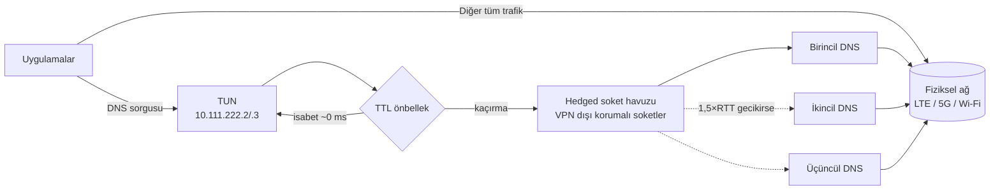

# NetPulse

**Lightweight, zero-drain local DNS proxy and real-time cellular diagnostics for Android.**

Android 12–17 · Herhangi bir üretici (OEM bağımsız) · Root gerekmez · Sadece açık AOSP API'leri

---

## Özellikler

| | |
|---|---|
| 🛡️ **Yerel DNS tüneli** | Yalnızca DNS trafiğini yakalayan `VpnService`. TTL'li önbellek, en hızlı sunucudan başlayıp gerekirse diğerlerini de yarıştıran (hedging) soket havuzu, TCP yedeği |
| 🎚️ **DNS profilleri** | Hız (Cloudflare/Google), Güvenlik (Quad9), Reklam engelleme (AdGuard), Özel IP. Tünel açıkken anında geçiş |
| 📶 **Canlı radyo ölçümü** | 5G SA/NSA, 4.5G ve LTE ayrımı; RSRP, RSRQ, SINR, 0–100 kalite skoru ve darboğaz tespiti |
| 📈 **Gecikme grafiği** | Son 30 saniyenin ping, jitter ve paket kaybı grafiği |
| 🗼 **Hücre bilgisi** | Operatör (MCC-MNC), eNodeB/gNodeB, PCI, TAC, band ve frekans |
| ⚡ **Hızlı Ayarlar kutucuğu** | Bildirim panelinden tek dokunuşla tüneli aç/kapat, canlı skoru gör (`92/100 • Mükemmel`) |
| 🎨 **Material You** | Dinamik renkler, dairesel skor göstergesi, haptik geri bildirim, tam edge-to-edge |

## Neden gecikme ve pil maliyeti yok?

Tünele **yalnızca iki sanal DNS adresi** yönlendirilir. Video, oyun ve indirme trafiği VPN'e hiç girmez,
normal yolundan gider. Uygulama sadece birkaç yüz baytlık DNS paketlerini işler.



- **Önbellek isabeti** ~0 ms. Hücresel ağda tipik DNS sorgusu 40–150 ms sürer.
- **Hedging:** önce en hızlı sunucu sorgulanır. EWMA RTT'nin 1,5 katı içinde yanıt gelmezse diğerleri de yarışa katılır,
  ilk geçerli yanıt kazanır. Paket kaybından kaynaklanan uzun takılmalar böylece kesilir.
- **Kalıcı soketler:** her sorgu için yeni soket açılmaz. Rastgele transaction-id ile çoğullama yapılır.
- **Boştayken sıfır uyanma:** TUN döngüsü `poll(-1)` ile çekirdekte bekler (zamanlayıcı yok). Kapatma sinyali bir self-pipe üzerinden gelir.
- **Pil:** ölçümler sadece uygulama görünürken (`ON_START`…`ON_STOP`) veya Hızlı Ayarlar paneli açıkken çalışır. Tünel sayaçları da sadece biri izlerken yayınlanır.
- **Kesintisiz:** uygulama son uygulamalardan kapatılsa bile tünel bağımsız foreground servis olarak çalışır.

## Sinyal parametreleri

| Parametre | Ne ölçer? | Mükemmel | Orta | Zayıf |
|---|---|---|---|---|
| **RSRP** | Baz istasyonundan gelen referans sinyal gücü (kapsama) | ≥ −85 dBm | −85…−105 dBm | ≤ −110 dBm |
| **RSRQ** | Sinyalin, toplam gürültü ve yüke oranı (hücre yoğunluğu) | ≥ −8 dB | −8…−15 dB | ≤ −18 dB |
| **SINR** | Sinyal / (girişim + gürültü) (hız potansiyeli) | ≥ 20 dB | 5…20 dB | < 0 dB |
| **RTT** | İnternete gidiş-dönüş gecikmesi (TCP el sıkışması) | ≤ 30 ms | 30…120 ms | ≥ 200 ms |

Skor = RSRP %35 + SINR %25 + RSRQ %15 + RTT %25. Paket kaybı varsa ceza uygulanır.
En zayıf bileşen "darboğaz" olarak gösterilir.

## Mimari

```
com.netpulse.optimizer
├── core/di        AppContainer: elle yazılmış DI (reflection yok, hızlı derleme)
├── domain         Saf Kotlin: modeller, DnsProfiles, SignalScorer
├── data
│   ├── connectivity   Fiziksel (VPN dışı) ağ, MTU, bant genişliği
│   ├── diagnostics    TelephonyCallback, CellIdentityReader, TCP RTT (Flow)
│   ├── settings       DnsSettingsRepository (profil ve özel IP)
│   └── vpn            VpnStateRepository (StateFlow, servis ↔ UI ↔ kutucuk)
├── vpn            LocalDnsVpnService, IPv4/UDP/TCP codec, DnsCache, DnsUpstreamPool, MtuResolver
├── optimizer      "Ağı Optimize Et" iş akışı
├── tile           DnsTileService (Hızlı Ayarlar)
└── ui             Compose: MainScreen, RadialGauge, LatencySparkline, DnsProfileCard, CellInfoCard
```

- **Coroutines ve StateFlow:** Tek veri kaynağı repository'lerdir. UI `WhileSubscribed(5s)` ile abone olur.
- **Android 14+:** `specialUse` tipinde foreground service, `FOREGROUND_SERVICE_SPECIAL_USE` izni ve Always-on VPN desteği.
- **Android 15–17:** zorunlu edge-to-edge (`WindowInsets.safeDrawing`), predictive back, `targetSdk 36`.
- **OEM bağımsız:** üreticiye özel intent veya gizli API yok. Ağ ayarları için sadece `ACTION_NETWORK_OPERATOR_SETTINGS`, `ACTION_WIRELESS_SETTINGS` ve `ACTION_SETTINGS` sırayla denenir.

## Kurulum

1. [Releases](../../releases/latest) sayfasından `app-debug.apk` dosyasını telefona indirin.
2. Dosyayı açın, **Bilinmeyen uygulamalara izin ver** seçeneğini açın ve **Yükle**'ye basın.
3. Uygulamada Telefon ve Konum izinlerini verin, **DNS Tüneli** anahtarını açın.
4. *(İsteğe bağlı)* Bildirim panelini aşağı çekin, ✏️ ile **NetPulse DNS** kutucuğunu ekleyin.

Kaynaktan derlemek için: `gradle :app:assembleDebug` (JDK 17, Gradle 8.14+). Her push'ta GitHub Actions APK'yı otomatik
derleyip Releases'e yükler.

## Bilinen sınırlar

- Android'de **Özel DNS** ayarı bir sunucu adına (katı mod) ayarlıysa DNS tünel yerine doğrudan DoT ile gider.
  Ayarı *Kapalı* veya *Otomatik* yapın.
- Bant ve RAT seçimini modem yapar. Uygulama bunu zorlayamaz, sadece operatör ağ ekranına yönlendirir.
- gNodeB ID, NCI değerinden 24 bitlik gNB ID varsayımıyla türetilir. Gerçek bit uzunluğunu operatör belirler.
- Bu sürümde upstream sorguları klasik UDP/TCP DNS ile yapılır. DoH/DoT, bağlantı yeniden kullanımıyla birlikte ileride eklenecek.

Sürüm geçmişi için: [CHANGELOG.md](CHANGELOG.md)
